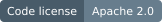
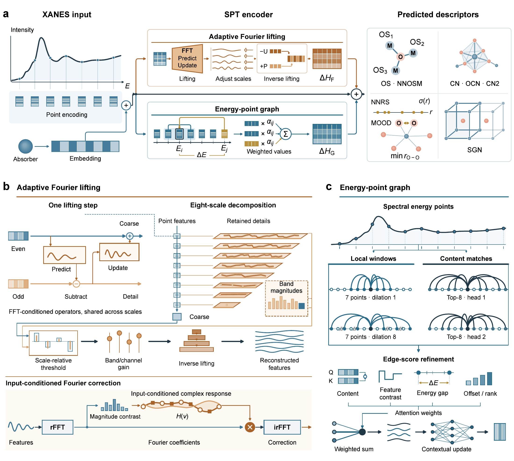

<h1 align="center">Spectral Pattern Translator (SPT)</h1>

<p align="center">
  <strong>Adaptive Fourier lifting for electronic and geometric descriptor inference from XANES</strong>
</p>

<p align="center">
  Suyang Zhong<sup>†</sup>, Boying Huang<sup>†</sup>, Pengwei Xu<sup>†</sup>, Fanjie Xu, Yuhao Zhao,<br>
  Jun Cheng<sup>*</sup>, Fujie Tang<sup>*</sup>, Weinan E, Zhong-Qun Tian
</p>

<p align="center">
  <sup>†</sup> Equal contribution &nbsp; · &nbsp; <sup>*</sup> Corresponding authors
</p>

<p align="center">
  <a href="https://github.com/zsy-suyang/SPT"></a>
  <a href="https://huggingface.co/datasets/zsysuyang/XAS_SPT"></a>
  <a href="LICENSE"></a>
</p>

<p align="center">
  <a href="#overview">Overview</a> ·
  <a href="#installation">Installation</a> ·
  <a href="#data-and-weights">Data &amp; weights</a> ·
  <a href="#quick-start">Quick start</a> ·
  <a href="#experiments">Experiments</a> ·
  <a href="#citation">Citation</a>
</p>

## Overview

This is the official code repository for SPT, a framework for inferring electronic, local-geometric and crystallographic descriptors from X-ray absorption near-edge structure (XANES). SPT combines adaptive Fourier lifting with energy-aware graph aggregation to represent spectral variation across scales and relationships between energy regions.



**SPT architecture.** (a) Spectrum encoding and descriptor prediction. (b) Input-conditioned Fourier lifting, scale-coefficient modulation and inverse lifting. (c) Local and non-local aggregation over spectral energy points. The example input is a computed Co K-edge spectrum; internal features, connections and descriptor glyphs are schematic.

| Component | Role |
| --- | --- |
| Adaptive Fourier lifting | Input-conditioned multiscale analysis, coefficient modulation and synthesis of energy-ordered spectral features. |
| Energy-aware graph aggregation | Combines neighbouring and separated spectral features using learned content relationships and energy separation. |
| Descriptor readout | Global and regional pooling feed classification and regression heads. Expert models predict one descriptor; Joint models share an encoder across descriptors within a site family. |

### Highlights

- **One architecture, 12 descriptor tasks.** Eight classification and four regression tasks cover electronic states, coordination, local geometry and crystallographic symmetry.
- **Leading scores across all evaluated descriptors.** Expert SPT achieves the highest test-set point estimates among the ten compared models across all 12 descriptor tasks on the computed oxide benchmark, measured by weighted F1 for classification and R² for regression.
- **From benchmarks to applications.** Experiment-specific interfaces cover computed spectra, measured reference and reaction-sequence spectra, matched noise comparisons and transfer learning.

### Supported descriptors

| Absorbing sites | Classification | Regression |
| --- | --- | --- |
| Non-oxygen | OS, CN, OCN, CN2, SGN | NNRS, MOOD |
| Oxygen | CN, CN2, SGN | NNRS, NNOSM |

OS: oxidation state; CN: coordination number; OCN: oxygen coordination number; CN2: two-hop neighbourhood count; SGN: space-group number; NNRS: nearest-neighbour radial standard deviation; MOOD: minimum first-shell O–O distance; NNOSM: nearest-neighbour oxidation-state mean.

Configuration files use `metal` for non-oxygen absorbing sites and `PSGO` for SGN. See [Architecture](docs/architecture.md) for the encoder and readout, and [Datasets](docs/datasets.md) for descriptor labels and input preparation.

## News

| Date | Update |
| --- | --- |
| 2026-10-24 | Code and experiment guides are available on GitHub; data and experiment-specific checkpoints are available on Hugging Face. |

## Installation

### 1. Create an environment

SPT supports Python 3.10–3.12. For example, create a Python 3.10 environment with conda:

```bash
conda create -n spt python=3.10 -y
conda activate spt
```

### 2. Clone and install

```bash
git clone --branch v0.1.0 https://github.com/zsy-suyang/SPT.git
cd SPT
python -m pip install -e .
spt --help
```

Use a PyTorch build appropriate for your CPU or CUDA environment. To evaluate the reported computed benchmark and noise experiments, follow the pinned Python 3.10 / CUDA 11.8 setup in [Numerical experiments](docs/reproduce.md#assets-and-environment). Prepared applications use their registered execution settings.

### 3. Install data and weights

Download the external assets below and place them in the repository before running inference or experiments. The code checkout includes the configurations, indices, fixed partitions and summary tables.

## Data and weights

| Package | Location | Contents |
| --- | --- | --- |
| Data | [XAS_SPT dataset](https://huggingface.co/datasets/zsysuyang/XAS_SPT) | Computed and measured inputs, source information and reference predictions |
| Weights | [XAS_SPT models](https://huggingface.co/zsysuyang/XAS_SPT) | Experiment-specific checkpoints and matching configurations |

Both collections use the release tag `2026-10-24` with [code version `v0.1.0`](https://github.com/zsy-suyang/SPT/tree/v0.1.0). The repository identifiers and versions are recorded in [configs/assets.json](configs/assets.json).

From the code repository root, install the assets into their expected directories:

```bash
python -m pip install "huggingface_hub>=2.3,<3"
hf download zsysuyang/XAS_SPT --repo-type dataset --revision 2026-10-24 --local-dir . --include "datasets/**" --include "data/**" --include "reference_predictions/**" --include "reference_results/**"
hf download zsysuyang/XAS_SPT --repo-type model --revision 2026-10-24 --local-dir . --include "checkpoints/**" --include "configs/**"
```

These commands retain the code checkout's root README and complete `data/asset_manifest.json`. For separate downloads and manual assembly, see [Download layout and versions](docs/releases.md).

[DATA_INDEX.csv](datasets/DATA_INDEX.csv) lists the inputs. [WEIGHT_INDEX.csv](checkpoints/WEIGHT_INDEX.csv) maps each experiment to its configurations and checkpoints. The [model registry](configs/registry.json) supplies these paths to the public commands.

After installing the assets:

```bash
spt list-models
spt verify-assets --all-assets
```

## Quick start

Run commands from the repository root after installing the required data and weights. Multi-line examples use Bash syntax; in PowerShell, enter each command on one line or replace the line-continuation character with a backtick.

### Predict a measured application

The Ni–Fe activation example reads eight prepared measured spectra and runs the corresponding OS, CN, OCN, NNRS and MOOD models on CPU:

```bash
spt application --cohort ni_fe_activation \
  --tasks OS CN OCN NNRS MOOD \
  --output outputs/ni_fe_activation.csv
```

The output CSV contains the descriptor predictions for each spectrum. The two Ni applications use their registered CPU settings; Li–Co–O, Co, Ti and Fe applications use CUDA. See [Application commands](docs/applications.md) for all cohorts and [Application spectra](docs/application-data.md) for measured-data sources and energy referencing.

### Predict a custom spectrum

Select a model from the registry and supply a CSV. This example uses the small synthetic spectrum included with the code to demonstrate the input format:

```bash
spt predict --model expert-metal-OS \
  --input examples/spectrum.csv \
  --output outputs/predictions.csv
```

The CSV contains `energy_eV`, `intensity` and `absorber` columns, with 256 ordered points per spectrum and absolute positive energies in eV. An optional `spectrum_id` column distinguishes multiple spectra. See [Datasets](docs/datasets.md) for preparation details.

## Experiments

Each guide provides the commands and corresponding configurations, data partitions and model identifiers. [Checkpoints](docs/checkpoints.md) explains the model mapping.

| Experiment | Data and model locations | Guide |
| --- | --- | --- |
| Computed benchmark | `datasets/computed/`, `checkpoints/benchmark/` | [Benchmark evaluation](docs/reproduce.md#computed-benchmark-and-architectural-controls) |
| Architectural controls | `datasets/computed/`, `checkpoints/ablations/` | [Ablations and fixed transforms](docs/reproduce.md#computed-benchmark-and-architectural-controls) |
| Gaussian noise comparison | `datasets/computed/`, `checkpoints/robustness/` | [Matched noise comparison](docs/reproduce.md#matched-clipped-gaussian-comparison) |
| Measurement and input controls | Computed and application inputs with their registered models | [SI controls](docs/reproduce.md#measurement-and-input-controls) |
| Spectral interventions | `datasets/computed/`, `checkpoints/interpretability/` | [Frequency interventions](docs/reproduce.md#input-frequency-interventions) |
| Uncertainty estimation | `datasets/computed/`, `checkpoints/uncertainty/` | [Monte Carlo dropout](docs/reproduce.md#monte-carlo-dropout-and-calibration) |
| Runtime measurements | `datasets/computed/`, `checkpoints/runtime/` | [Runtime](docs/reproduce.md#runtime) |
| Measured and computed applications | `datasets/applications/`, `checkpoints/applications/` | [Application inference](docs/applications.md) |
| Transfer learning | `datasets/transfer/`, `checkpoints/transfer/` | [Transfer experiments](docs/transfer.md) |

Retraining commands for supported neural models are described in [Numerical experiments](docs/reproduce.md#computed-benchmark-and-architectural-controls). Evaluate the supplied tree estimators through the benchmark interface.

## Repository structure

After assembling the code, data and weight packages:

```text
SPT/
├── spt/                    # Model, training and inference code
├── configs/                # Model and experiment configurations
├── data/                   # Fixed partitions and asset manifest
├── datasets/               # Computed and measured inputs (data download)
├── reference_predictions/  # Per-spectrum results (data download)
├── reference_results/      # Numerical summaries
├── checkpoints/            # Experiment-specific weights (weight download)
├── examples/               # Small synthetic input example
├── docs/                   # Framework figure and experiment guides
├── tests/                  # Software and reference-replay tests
├── CITATION.cff
├── LICENSE
└── README.md
```

Fixed computed-data partitions are in `data/splits/final/`.

## Tests

```bash
python -m pip install -e '.[dev]'
python -m pytest -q
```

The tests cover input preparation, model operations and experiment protocols. With the Ni–Fe data and weights installed, they also replay its eight-spectrum application.

## Citation

Please cite the accompanying manuscript using [CITATION.cff](CITATION.cff):

> Suyang Zhong, Boying Huang, Pengwei Xu, Fanjie Xu, Yuhao Zhao, Jun Cheng, Fujie Tang, Weinan E and Zhong-Qun Tian. *Adaptive Fourier lifting for electronic and geometric descriptor inference from XANES.*

## Contact

For code and usage questions, please open a [GitHub issue](https://github.com/zsy-suyang/SPT/issues). Scientific correspondence: [Jun Cheng](mailto:chengjun@xmu.edu.cn) and [Fujie Tang](mailto:tangfujie@xmu.edu.cn).

## License

The repository's source-code license is [Apache 2.0](LICENSE). Third-party software and adapted components retain their own terms; see [THIRD_PARTY_NOTICES.md](THIRD_PARTY_NOTICES.md). This license does not relicense third-party spectra or structures. Data and checkpoint reuse terms are described in the [dataset card](https://huggingface.co/datasets/zsysuyang/XAS_SPT) and [model card](https://huggingface.co/zsysuyang/XAS_SPT).
